# Flowrist — Flower Delivery App

A cross-platform Flutter application for browsing, ordering, and tracking flower deliveries, backed by a .NET microservices platform (identity, catalog, cart, orders, payments, address). Originally built as a team project; this repository is an independent, actively maintained continuation.

## Overview

Flowrist lets customers browse a flower catalog, manage a cart, check out, pay, and track order status end to end. The mobile app talks to a backend of independent microservices (Identity, Catalog, Cart, Order, Payment, Address) behind an API gateway, with Firebase used for push notifications.

## My Role

I worked as a Flutter/mobile developer on the team that built this app, contributing to the mobile client within the Clean Architecture structure shared across the codebase. This repository is maintained independently going forward under my own account, with permission from the original team.

## Features

- Authentication: sign up, login, OTP verification, forgot/reset password, session management
- Product catalog browsing with pagination and image caching
- Shopping cart and checkout flow
- Address management with map-based location picking
- Order placement and order history/tracking
- Payment integration
- Push notifications (Firebase Cloud Messaging)
- Profile management
- Localization (Arabic/English) with RTL support
- Light/dark theming and responsive layouts

## Tech Stack

**Mobile (Flutter)**
- State management: `flutter_bloc`
- Dependency injection: `get_it` + `injectable`
- Networking: `dio` + `retrofit`, with interceptor-based logging
- Local/secure storage: `shared_preferences`, `flutter_secure_storage`
- Code generation: `freezed`, `json_serializable`, `build_runner`
- Routing: `go_router`
- Maps & location: `flutter_map`, `geolocator`, `geocoding`
- Push notifications: `firebase_messaging`, `firebase_core`, `flutter_local_notifications`
- Localization: `easy_localization`
- UI: `flutter_screenutil`, `flutter_svg`, `cached_network_image`, `shimmer`, `infinite_scroll_pagination`
- Testing: `flutter_test`, `mockito`, `bloc_test`

**Backend**
- .NET microservices (Identity, Catalog, Cart, Order, Payment, Address) behind an API gateway
- SQL Server, RabbitMQ (messaging), Redis
- Stripe (payments), Firebase Admin (push), SMTP (email)
- Docker Compose for local orchestration (see `FlowerApp-Backend/`)

## Architecture

The mobile app follows **Clean Architecture** with a **feature-first** folder structure:

```
lib/
├── app/            # App-level bootstrap, layout, routing
├── core/            # Shared infrastructure: DI, networking, theming, localization, errors, widgets
└── features/
    ├── auth/
    ├── cart/
    ├── address/
    ├── commerce/
    ├── notification/
    ├── order/
    ├── payment/
    ├── profile/
    └── sessions/
```

Each feature is organized into `data` / `domain` / `presentation` layers, with BLoC/Cubit driving presentation state and dependency injection wiring data sources through repositories into use cases.

## Application Screenshots

Screens below are taken from the project's Figma design file and exported as PNG (3x, 1125 px wide). They are grouped by user flow.

### Authentication

<table>
  <tr>
    <td align="center" valign="top" width="33%">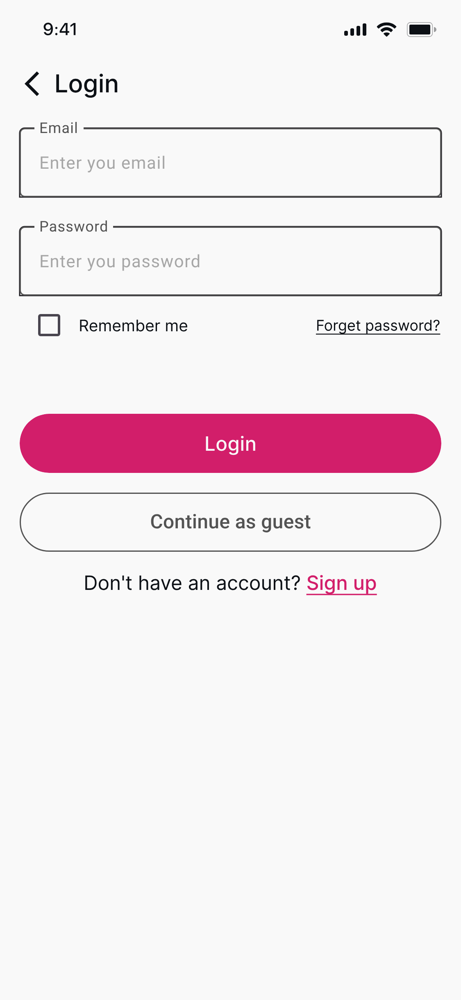<br><sub><b>Login</b></sub></td>
    <td align="center" valign="top" width="33%">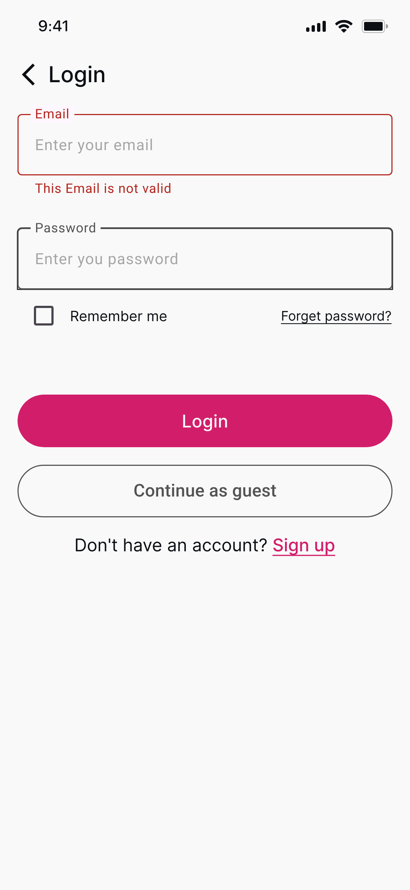<br><sub><b>Login — email error</b></sub></td>
    <td align="center" valign="top" width="33%">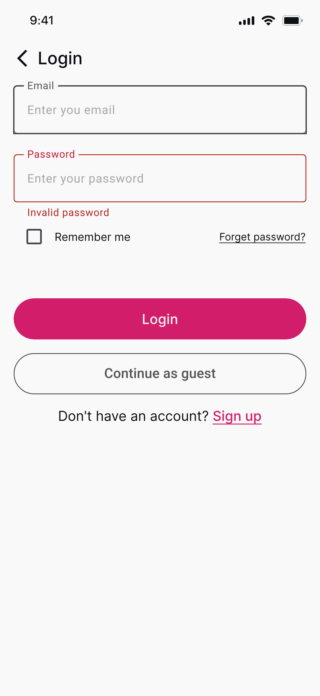<br><sub><b>Login — password error</b></sub></td>
  </tr>
  <tr>
    <td align="center" valign="top" width="33%">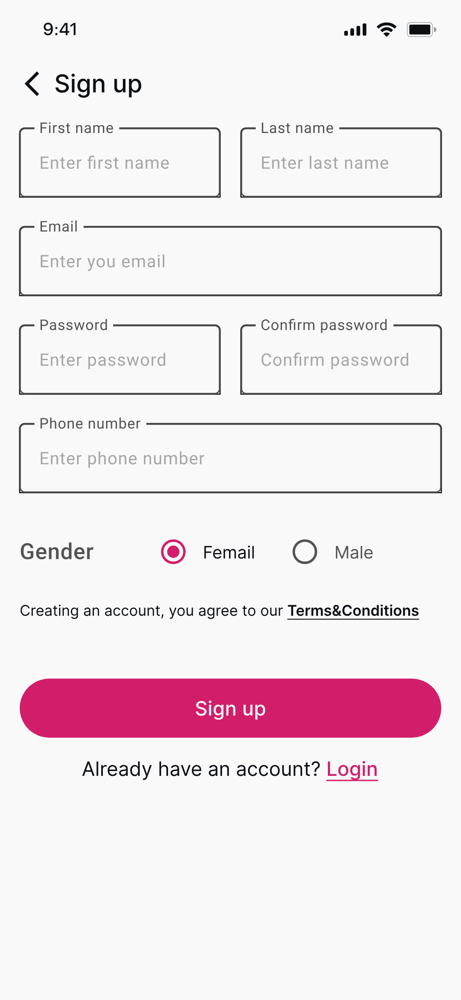<br><sub><b>Sign up</b></sub></td>
    <td align="center" valign="top" width="33%">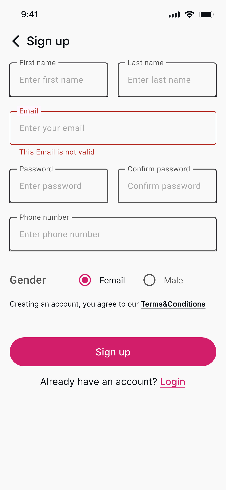<br><sub><b>Sign up — email error</b></sub></td>
    <td align="center" valign="top" width="33%">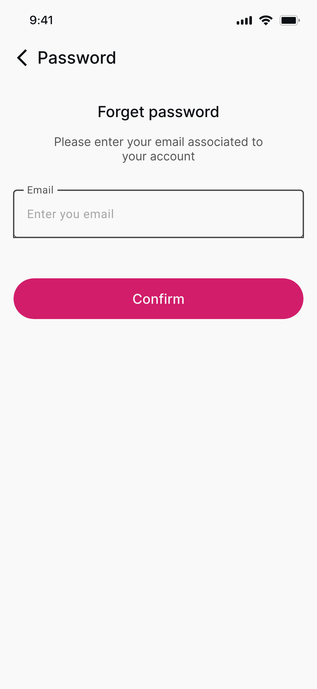<br><sub><b>Forgot password</b></sub></td>
  </tr>
  <tr>
    <td align="center" valign="top" width="33%">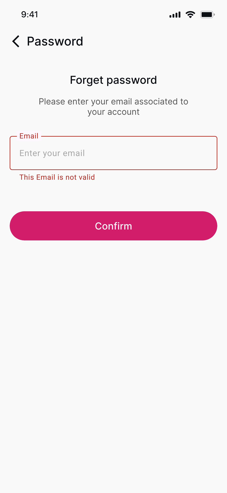<br><sub><b>Forgot password — invalid email</b></sub></td>
    <td align="center" valign="top" width="33%">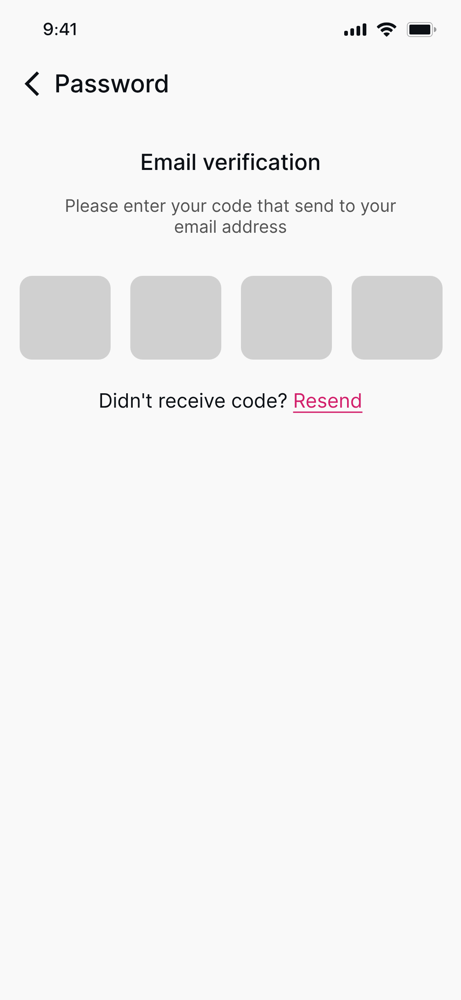<br><sub><b>Email verification</b></sub></td>
    <td align="center" valign="top" width="33%">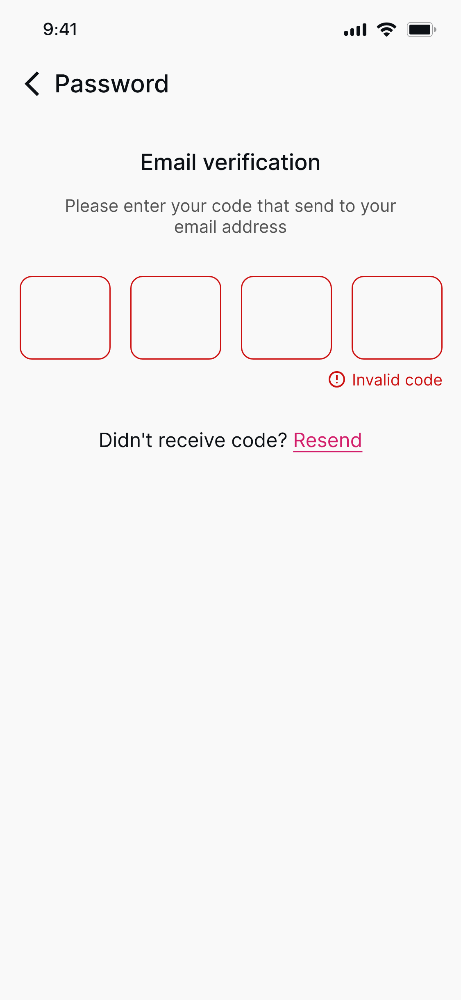<br><sub><b>Email verification — invalid code</b></sub></td>
  </tr>
  <tr>
    <td align="center" valign="top" width="33%">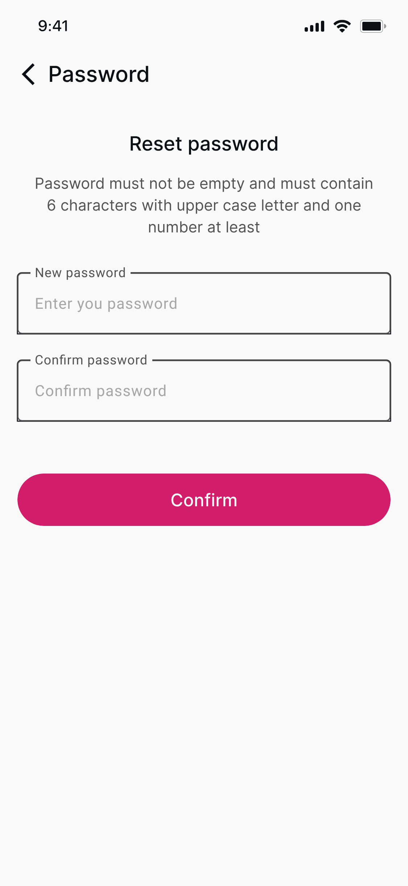<br><sub><b>Set new password</b></sub></td>
    <td width="33%"></td>
    <td width="33%"></td>
  </tr>
</table>

### Browse & Catalogue

<table>
  <tr>
    <td align="center" valign="top" width="33%"><br><sub><b>Home</b></sub></td>
    <td align="center" valign="top" width="33%">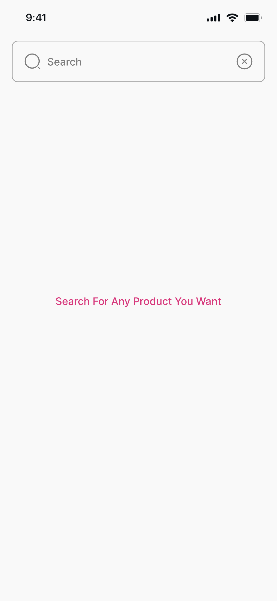<br><sub><b>Search — empty state</b></sub></td>
    <td align="center" valign="top" width="33%"><br><sub><b>Search — results</b></sub></td>
  </tr>
  <tr>
    <td align="center" valign="top" width="33%"><br><sub><b>Categories</b></sub></td>
    <td align="center" valign="top" width="33%">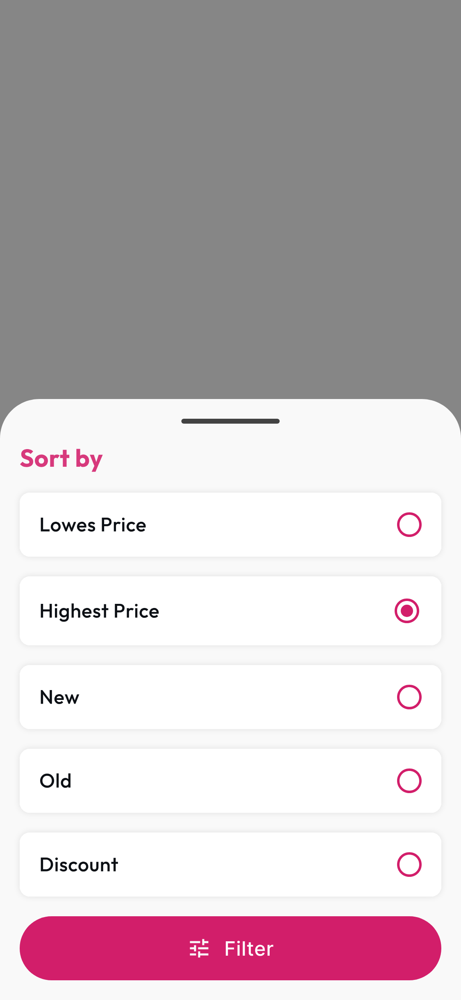<br><sub><b>Categories — sort sheet</b></sub></td>
    <td align="center" valign="top" width="33%"><br><sub><b>Best sellers</b></sub></td>
  </tr>
  <tr>
    <td align="center" valign="top" width="33%">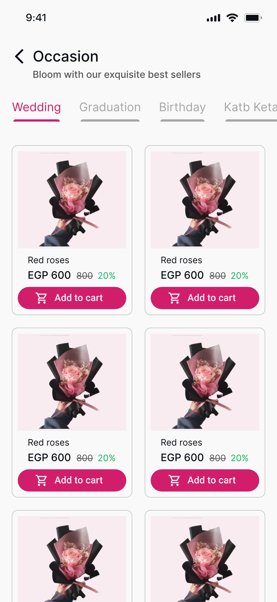<br><sub><b>Occasions</b></sub></td>
    <td align="center" valign="top" width="33%"><br><sub><b>Product details</b></sub></td>
    <td width="33%"></td>
  </tr>
</table>

### Cart & Checkout

<table>
  <tr>
    <td align="center" valign="top" width="33%"><br><sub><b>Cart</b></sub></td>
    <td align="center" valign="top" width="33%"><br><sub><b>Checkout — shipping & payment</b></sub></td>
    <td align="center" valign="top" width="33%"><br><sub><b>Order placed</b></sub></td>
  </tr>
</table>

### Orders & Tracking

<table>
  <tr>
    <td align="center" valign="top" width="33%"><br><sub><b>Tracking — order received</b></sub></td>
    <td align="center" valign="top" width="33%"><br><sub><b>Tracking — live map</b></sub></td>
    <td align="center" valign="top" width="33%">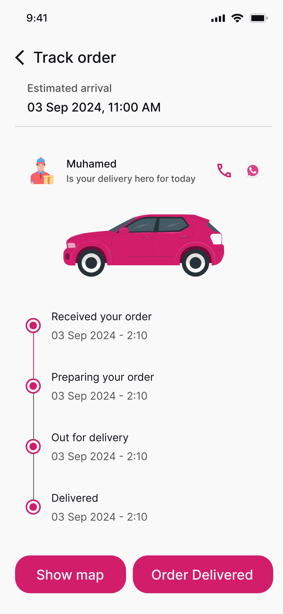<br><sub><b>Tracking — delivered</b></sub></td>
  </tr>
  <tr>
    <td align="center" valign="top" width="33%"><br><sub><b>My orders — Active</b></sub></td>
    <td align="center" valign="top" width="33%">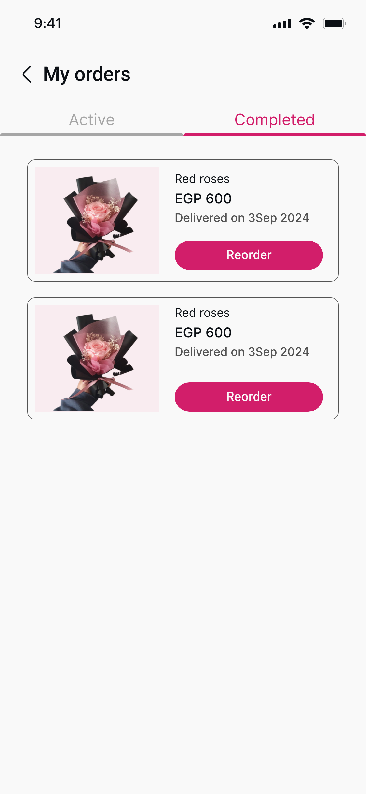<br><sub><b>My orders — Completed</b></sub></td>
    <td width="33%"></td>
  </tr>
</table>

### Account & Profile

<table>
  <tr>
    <td align="center" valign="top" width="33%"><br><sub><b>Profile</b></sub></td>
    <td align="center" valign="top" width="33%">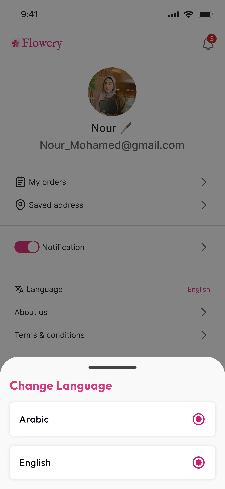<br><sub><b>Profile — change language</b></sub></td>
    <td align="center" valign="top" width="33%">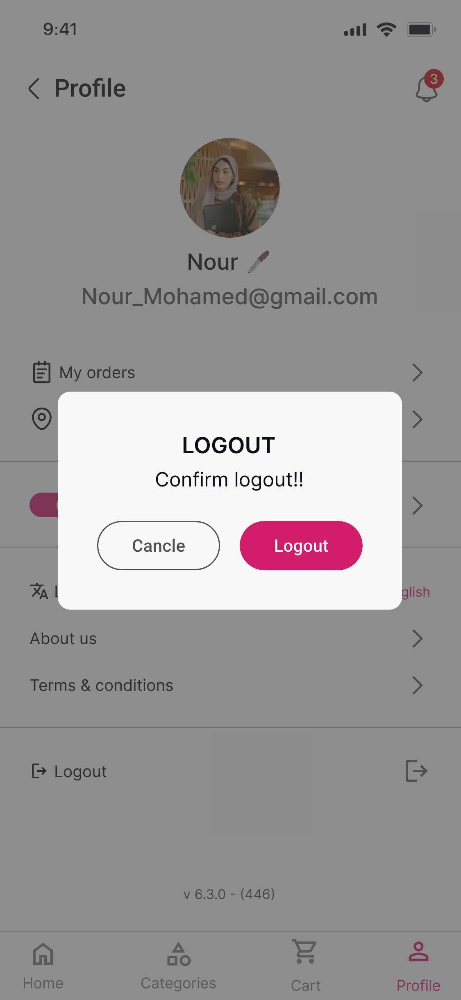<br><sub><b>Profile — logout confirmation</b></sub></td>
  </tr>
  <tr>
    <td align="center" valign="top" width="33%">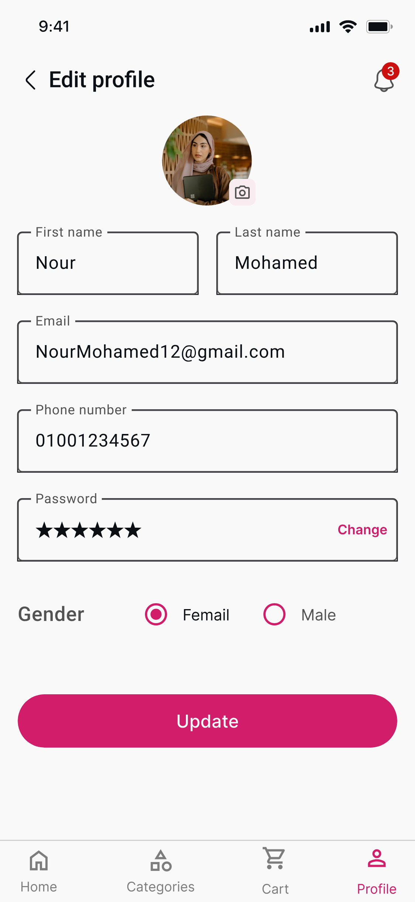<br><sub><b>Edit profile</b></sub></td>
    <td align="center" valign="top" width="33%">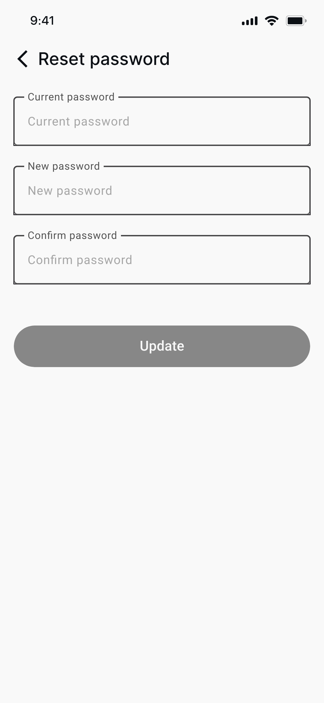<br><sub><b>Change password</b></sub></td>
    <td align="center" valign="top" width="33%">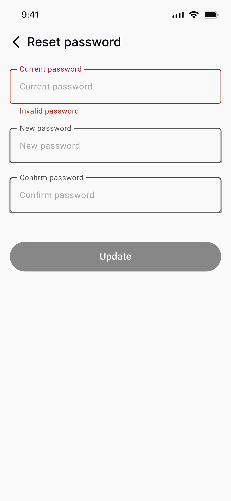<br><sub><b>Change password — error</b></sub></td>
  </tr>
  <tr>
    <td align="center" valign="top" width="33%">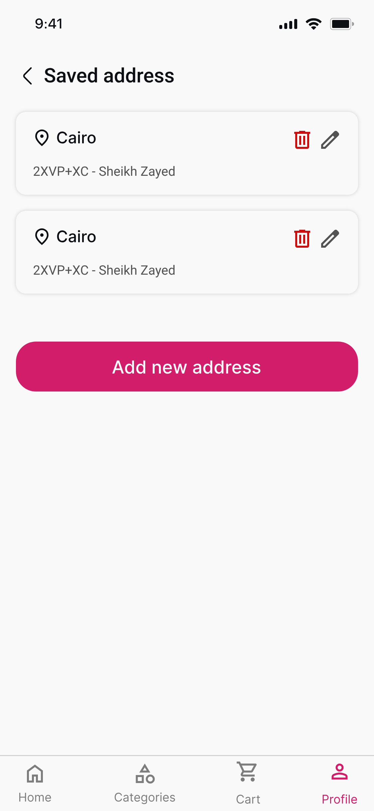<br><sub><b>Saved addresses</b></sub></td>
    <td align="center" valign="top" width="33%">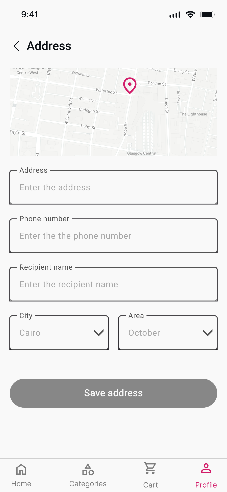<br><sub><b>Add address</b></sub></td>
    <td align="center" valign="top" width="33%">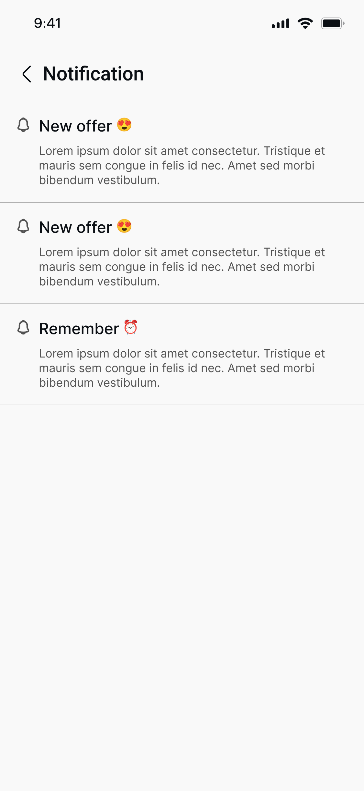<br><sub><b>Notifications</b></sub></td>
  </tr>
</table>

## Getting Started

### Prerequisites
- Flutter SDK (see `.fvmrc` / `.metadata` for the pinned version; FVM recommended)
- A `.env` file at the project root (see `.env.example`) for runtime configuration
- Firebase project credentials (`google-services.json` for Android is already included; configure your own Firebase project if you fork this)
- Docker, for running the backend locally (see `FlowerApp-Backend/`)

### Setup

```bash
# Install Flutter dependencies
flutter pub get

# Generate code (DI, freezed, json_serializable, retrofit)
dart run build_runner build --delete-conflicting-outputs

# Run the app
flutter run
```

### Backend (optional, for local full-stack development)

```bash
cd FlowerApp-Backend
./setup.sh --recreate
```

This spins up the microservices stack via Docker Compose. Copy the generated `.env` and replace the placeholder credentials (`JWT_SECRET`, `EMAIL_USERNAME`, `EMAIL_PASSWORD`, `Stripe__SecretKey`, etc.) with your own before using it beyond local testing — **never commit real secrets to this file**.

## Testing

```bash
flutter test
```

## Provenance

This app was originally developed collaboratively by a team (originally hosted at `menna-ahmed123/Flower-App`). It is now maintained independently here with the original contributors' permission, as a standalone continuation of that work.
