<div align="center">

# Flowrist

### Flower Delivery App

A cross-platform Flutter application for browsing, ordering, and tracking flower deliveries,<br>backed by a .NET microservices platform.

    

<table>
  <tr>
    <td align="center" width="33%">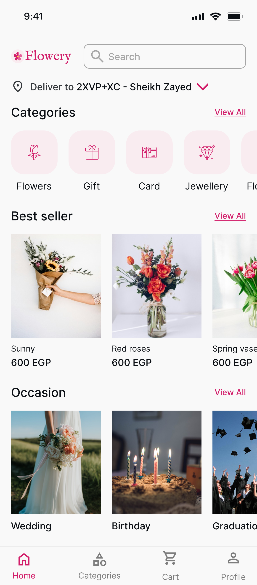<br><sub><b>Home</b></sub></td>
    <td align="center" width="33%">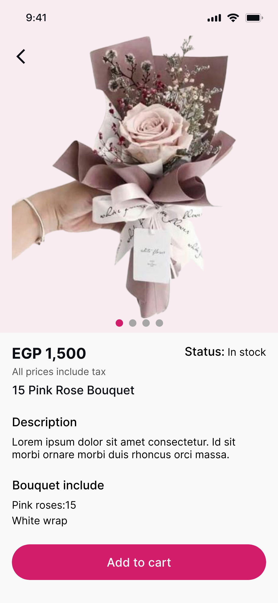<br><sub><b>Product details</b></sub></td>
    <td align="center" width="33%">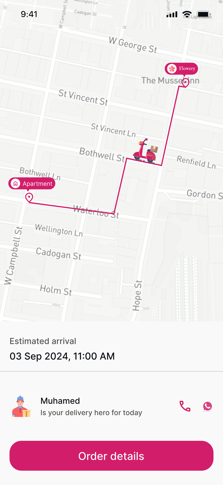<br><sub><b>Live order tracking</b></sub></td>
  </tr>
</table>

</div>

---

## Table of Contents

- [Overview](#overview)
- [My Role](#my-role)
- [Features](#features)
- [Tech Stack](#tech-stack)
- [Architecture](#architecture)
- [Application Screenshots](#application-screenshots)
- [Getting Started](#getting-started)
- [Testing](#testing)
- [Provenance](#provenance)

---

## Overview

Flowrist lets customers browse a flower catalog, manage a cart, check out, pay, and track order
status end to end. The mobile app talks to a backend of independent microservices (Identity,
Catalog, Cart, Order, Payment, Address) behind an API gateway, with Firebase used for push
notifications.

Originally built as a team project; this repository is an independent, actively maintained
continuation.

---

## My Role

I worked as a Flutter/mobile developer on the team that built this app, contributing to the mobile
client within the Clean Architecture structure shared across the codebase. This repository is
maintained independently going forward under my own account, with permission from the original team.

---

## Features

| Area | Capabilities |
| :--- | :--- |
| **Authentication** | Sign up, login, OTP verification, forgot/reset password, session management |
| **Catalog** | Product browsing with pagination and image caching |
| **Cart & Checkout** | Shopping cart and checkout flow |
| **Addresses** | Address management with map-based location picking |
| **Orders** | Order placement, order history and tracking |
| **Payments** | Payment integration |
| **Notifications** | Push notifications via Firebase Cloud Messaging |
| **Profile** | Profile management |
| **Localization** | Arabic / English with RTL support |
| **Theming** | Light and dark themes, responsive layouts |

---

## Tech Stack

### Mobile (Flutter)

| Concern | Libraries |
| :--- | :--- |
| State management | `flutter_bloc` |
| Dependency injection | `get_it`, `injectable` |
| Networking | `dio`, `retrofit` (interceptor-based logging) |
| Local & secure storage | `shared_preferences`, `flutter_secure_storage` |
| Code generation | `freezed`, `json_serializable`, `build_runner` |
| Routing | `go_router` |
| Maps & location | `flutter_map`, `geolocator`, `geocoding` |
| Push notifications | `firebase_messaging`, `firebase_core`, `flutter_local_notifications` |
| Localization | `easy_localization` |
| UI | `flutter_screenutil`, `flutter_svg`, `cached_network_image`, `shimmer`, `infinite_scroll_pagination` |
| Testing | `flutter_test`, `mockito`, `bloc_test` |

### Backend

- .NET microservices (Identity, Catalog, Cart, Order, Payment, Address) behind an API gateway
- SQL Server, RabbitMQ (messaging), Redis
- Stripe (payments), Firebase Admin (push), SMTP (email)
- Docker Compose for local orchestration (see `FlowerApp-Backend/`)

---

## Architecture

The mobile app follows **Clean Architecture** with a **feature-first** folder structure:

```text
lib/
├── app/             # App-level bootstrap, layout, routing
├── core/            # Shared infrastructure: DI, networking, theming,
│                    # localization, errors, widgets
└── features/
    ├── auth/
    ├── cart/
    ├── address/
    ├── commerce/
    ├── notification/
    ├── order/
    ├── payment/
    ├── profile/
    └── sessions/
```

Each feature is organized into `data` / `domain` / `presentation` layers, with BLoC/Cubit driving
presentation state and dependency injection wiring data sources through repositories into use cases.

---

## Application Screenshots

A selection of the main screens, taken from the project's Figma design file. They follow the core shopping journey: discover a product, check out, then track the order.

### Browse & Discover

Catalog browsing, curated collections and search.

<table>
  <tr>
    <td align="center" valign="top" width="33%">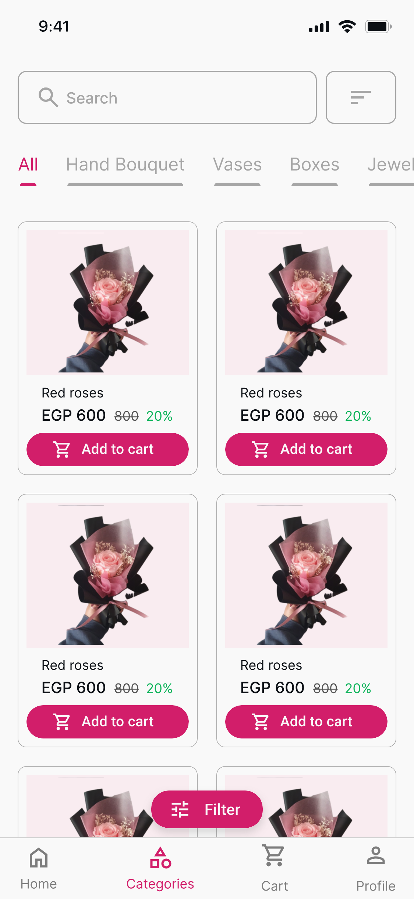<br><sub><b>Categories</b></sub></td>
    <td align="center" valign="top" width="33%">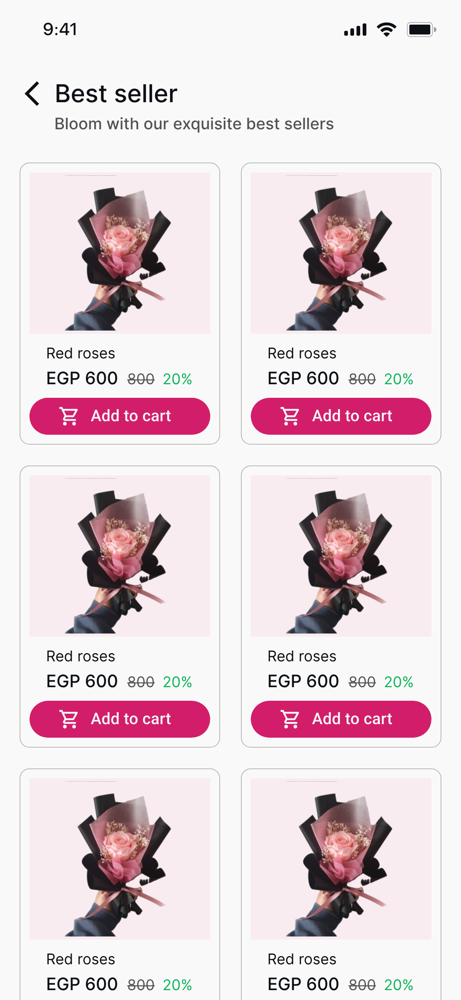<br><sub><b>Best sellers</b></sub></td>
    <td align="center" valign="top" width="33%">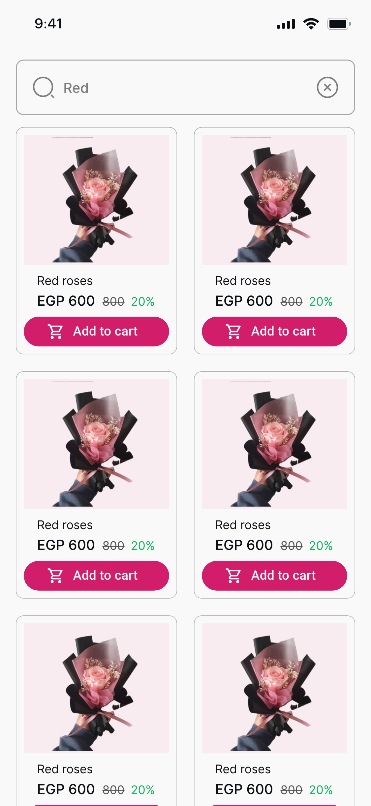<br><sub><b>Search results</b></sub></td>
  </tr>
</table>

### Cart & Checkout

From cart to a placed order, including delivery and payment selection.

<table>
  <tr>
    <td align="center" valign="top" width="33%">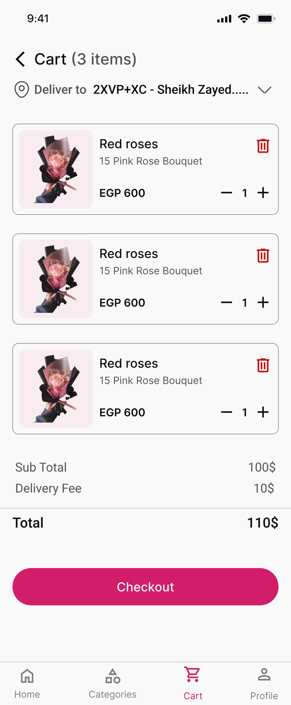<br><sub><b>Cart</b></sub></td>
    <td align="center" valign="top" width="33%">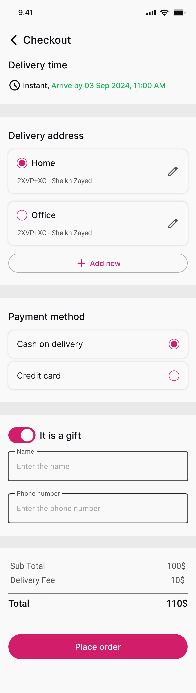<br><sub><b>Checkout</b></sub></td>
    <td align="center" valign="top" width="33%">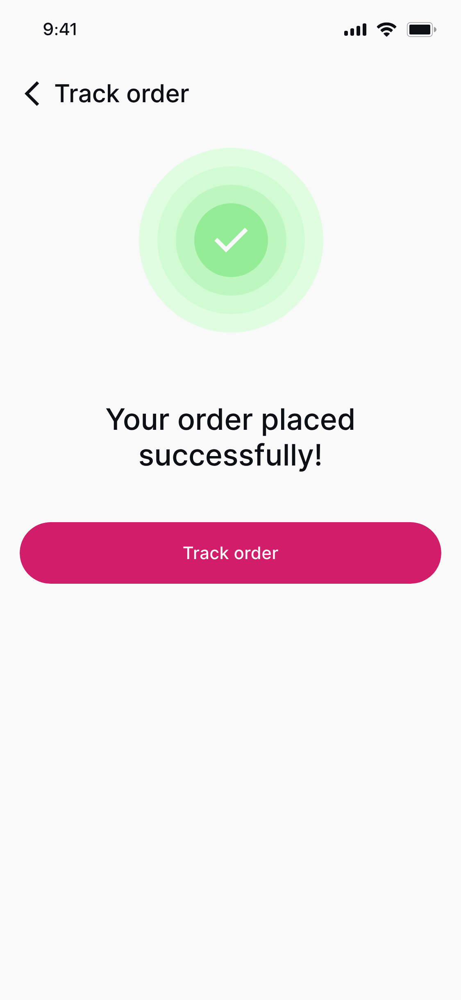<br><sub><b>Order placed</b></sub></td>
  </tr>
</table>

### Tracking & Account

Live delivery status, order history and profile management.

<table>
  <tr>
    <td align="center" valign="top" width="33%">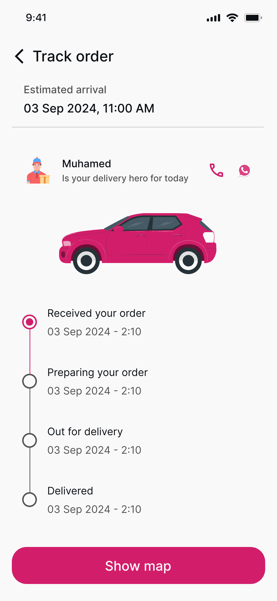<br><sub><b>Order tracking</b></sub></td>
    <td align="center" valign="top" width="33%">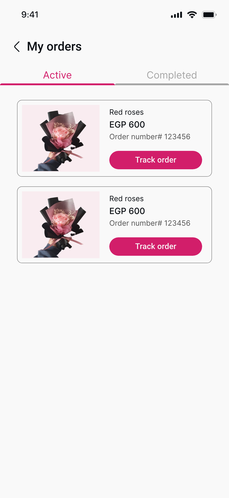<br><sub><b>My orders</b></sub></td>
    <td align="center" valign="top" width="33%">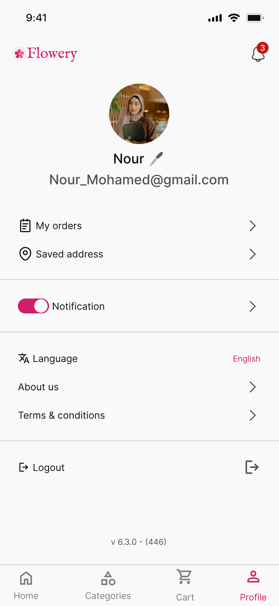<br><sub><b>Profile</b></sub></td>
  </tr>
</table>

> The complete screen-by-screen set, including validation and error states, is available in [`assets/screenshots/`](assets/screenshots/).

---

## Getting Started

### Prerequisites

- **Flutter SDK** — see `.fvmrc` / `.metadata` for the pinned version (FVM recommended)
- **`.env` file** at the project root — see `.env.example` for runtime configuration
- **Firebase credentials** — `google-services.json` for Android is already included; configure your
  own Firebase project if you fork this
- **Docker** — only if you want to run the backend locally (see `FlowerApp-Backend/`)

### Setup

```bash
# 1. Install Flutter dependencies
flutter pub get

# 2. Generate code (DI, freezed, json_serializable, retrofit)
dart run build_runner build --delete-conflicting-outputs

# 3. Run the app
flutter run
```

### Backend (optional, for local full-stack development)

```bash
cd FlowerApp-Backend
./setup.sh --recreate
```

This spins up the microservices stack via Docker Compose.

> **Security note**
> Copy the generated `.env` and replace the placeholder credentials (`JWT_SECRET`,
> `EMAIL_USERNAME`, `EMAIL_PASSWORD`, `Stripe__SecretKey`, and similar) with your own before using
> it beyond local testing. **Never commit real secrets to this file.**

---

## Testing

```bash
flutter test
```

---

## Provenance

This app was originally developed collaboratively by a team (originally hosted at
`menna-ahmed123/Flower-App`). It is now maintained independently here with the original
contributors' permission, as a standalone continuation of that work.
